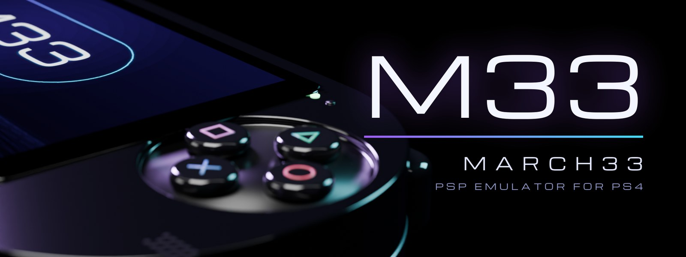

  

  
  
  
  
  

<h3 align="center">Your PSP library, on the PS4.</h3>

  <a href="https://github.com/iHaiDeeZ/M33/releases/latest"><b>⬇ Get the latest version</b></a> ·
  <a href="#getting-started">Getting started</a> ·
  <a href="#controls">Controls</a> ·
  <a href="#game-compatibility">Compatibility</a> ·
  <a href="#faq">FAQ</a> ·
  <a href="https://discord.gg/fqjMs9gDJh">Discord</a>

---

## Overview

M33 (March33) brings the [PPSSPP](https://www.ppsspp.org) PSP emulator to jailbroken PS4 consoles
as an app you launch from the home screen like any other. Pick a game, press **Cross**, and play
with a DualShock 4. Pressing **L3 + R3** during a game opens a quick menu made for the controller:
save states with their pictures, cheats, rewind, the picture and sound settings, restart or quit.

With the PSP's own firmware installed (M33 downloads it from Sony for you), the real **XMB** starts
your games the way a PSP does, with its own game boot animation.

Under the hood, PPSSPP's JIT turns the PSP's MIPS code into x86-64 code for the PS4's CPU, and
rendering goes through Vulkan: Mesa's RADV driver, adapted to submit work directly to the PS4's AMD
GPU.

You bring your own game backups. Nothing copyrighted is bundled: no games, no firmware.

## Highlights

**A PSP, as it was**
- **The XMB**: with PSP firmware 6.61 installed, M33 can start straight into the PSP's own menu.
  Every disc game in your folder shows up in its Game column. Hold **L1** while M33 opens to skip it.
- **The game boot**: starting a game plays the firmware's real startup and game boot animation,
  from the XMB or from M33's own game list.
- **One button to get the firmware**: *Settings → System → PSP Firmware → Download PSP firmware 6.61
  from Sony* fetches Sony's own updater and installs it.

**A quick menu made for the couch (L3 + R3)**
- The paused game behind a panel that slides in, rows with icons, values changed with Left / Right.
- **Save State / Load State** by slot, with the slot's picture, date and time beside the menu.
- **Cheats**: turn each one on or off. The game's codes come from PPSSPP's CWCheat database,
  downloaded the first time.
- **Rewind**, **Frame Generation**, **Resolution**, **Game Volume** and the **FPS Counter**, applied
  at once. **Settings** opens all of PPSSPP's settings; **Display & Effects** its picture options.

**Rewind, the way RetroArch does it**
- Hold **L2** and the game plays backwards; let go and it carries on from there. Hold again to go
  further back. On or off per game.

**A sharp picture**
- Rendered at 4x (1920x1088, the TV's 1080p) with AMD FidelityFX's sharpening (FSR RCAS).
- **Frame Generation** (experimental, off by default): a game running at 30 is shown at 60, with a
  frame made between every two. Works best in games with a steady 30 fps.

**Everything else you'd expect**
- **RetroAchievements**, online.
- The PS4's own keyboard for text, with **Cross** to confirm.
- A 3D animated startup and M33's own theme, icon and menu sounds.

## Getting started

**You need:** a jailbroken PS4 with **GoldHEN**, an FTP connection to it, and dumps of PSP games
you own.

1. Grab the latest **`M33-vX.XX.pkg`** from the [releases page](https://github.com/iHaiDeeZ/M33/releases/latest)
   and install it with GoldHEN's **Package Installer**.
2. Start **M33** once: it creates **`/data/March33/`**.
3. Put your games in **`/data/March33/games/`** (`.iso`, `.cso`, `.chd`). Homebrew and PSN games
   (`EBOOT.PBP` in their own folder) go in **`/data/March33/PSP/GAME/`**.
4. *(Optional, for the XMB and the game boot)* **Settings → System → PSP Firmware → Download PSP
   firmware 6.61 from Sony**. If your console can't reach Sony's server, copy Sony's 6.61 update
   (`EBOOT.PBP`) to `/data/March33/firmware/PSP661_EBOOT.PBP` and press it again.

**Updating M33:** install the newer package on top of the old one. Everything you've set up lives in
`/data/March33/` and survives updates. The version is in the corner of the opening animation.

## Controls

### While playing

| DualShock 4 | PSP |
|---|---|
| Cross / Circle / Square / Triangle | Cross / Circle / Square / Triangle |
| D-pad | D-pad |
| Left stick | Analog stick |
| L1 / R1 | L / R |
| OPTIONS | START |
| Touchpad click | SELECT |
| **L2 (hold)** | **Rewind** |
| R2 | Fast-forward |
| **L3 + R3** | **Quick menu** |
| Right stick, L3, R3 | Free to map (Settings → Controls) |

### In the quick menu

| Press | To |
|---|---|
| D-pad / left stick | Move |
| Left / Right | Change a value (save slot, resolution, volume...) |
| Cross | Select / turn on or off |
| Circle, or L3 + R3 again | Back to the game |

## Settings at a glance

M33 keeps **all of PPSSPP's settings** (quick menu → *Settings*), with these defaults for the PS4:

| Setting | M33's default |
|---|---|
| Rendering resolution | 4x (1920x1088) |
| Post-processing | FSR RCAS (sharpening); add FSR EASU for lower resolutions in *Display & Effects* |
| Menu sounds | On |
| Rewind | On (per game) |
| Frame Generation | Off (per game) |
| Start in the XMB | Off (*Settings → System → PSP Firmware*) |

## Your files

Everything the app creates sits in **`/data/March33/`**:

- `games/`: your disc games
- `PSP/`: the PSP memory stick: `SAVEDATA` (your saves), `PPSSPP_STATE` (save states and their
  pictures), `GAME` (homebrew), `Cheats` (cheat files and the database), `SYSTEM` (settings)
- `PSP/NAND/`: the installed PSP firmware
- `firmware/`: the firmware updater, once downloaded
- `ppsspp.log`, `boot-trace.log`, `crash.log`, `hang.log`: logs for bug reports

## Game compatibility

| Status | Meaning |
|---|---|
|  | Runs well enough to play through |
|  | Starts and plays; not measured yet |
|  | Gets into the game, but slowdowns, glitches or freezes get in the way |
|  | Doesn't start, or closes right away |

**Tested by us** on a launch-model PS4:

| Status | Game | Notes |
|---|---|---|
|  | Grand Theft Auto: Liberty City Stories | 30 fps (its normal rate), full speed. Some hitches in busy scenes. Its 60 FPS cheat is too heavy for the PS4: the game runs in slow motion. |
|  | God of War: Ghost of Sparta | |
|  | God of War: Chains of Olympus | |
|  | LittleBigPlanet | |
|  | SSX on Tour | |

PPSSPP itself runs most of the PSP library: see its [compatibility list](https://report.ppsspp.org/games).
Tested a game? Tell us on [Discord](https://discord.gg/fqjMs9gDJh) or
[open an issue](https://github.com/iHaiDeeZ/M33/issues) with the game, its region, and how it ran.

## FAQ

**Why does a game stutter in busy scenes?**
The PS4's CPU is usually the limit. Turn **Rewind** off for that game (quick menu), and on a PS4 Pro
turn on **Boost Mode** in the PS4's settings. A game's first minutes can also hitch while its
shaders are compiled; they're kept for next time.

**Can games run at 60 fps?**
Most PSP games run at 30. Their *60 FPS* cheats make the game itself run twice as fast, which the PS4
usually can't keep up with. Try **Frame Generation** instead: the game keeps its speed and you see 60.

**Where are my saves?**
In `/data/March33/PSP/SAVEDATA`, as on a PSP's memory stick: you can copy them to and from a real
PSP or PPSSPP on another device.

**The firmware download fails.**
Jailbroken consoles often block Sony's servers. M33 then asks public DNS servers itself; if it still
can't get through, copy the updater over FTP as in [Getting started](#getting-started).

**How do I report a bug?**
On [Discord](https://discord.gg/fqjMs9gDJh) or in an [issue](https://github.com/iHaiDeeZ/M33/issues).
Attach `ppsspp.log`, `boot-trace.log` and, if there is one, `crash.log` or `hang.log` from
`/data/March33/`, and mention the game, its region, the M33 version, your PS4 model and firmware.

## Community

Join the **[M33 Discord](https://discord.gg/fqjMs9gDJh)** for help, game reports and news.

## For developers

How the port works (the Vulkan window system on VideoOut, the memory arena, the JIT, the XMB and the
firmware game boot) and how to build it: **[docs/TECHNICAL.md](docs/TECHNICAL.md)**.

## Thanks

- **[PPSSPP](https://github.com/hrydgard/ppsspp)**: the emulator itself, by **Henrik Rydgård** and
  everyone who has contributed to it
- **[Mesa](https://mesa3d.org)**: the RADV Vulkan driver that draws every frame
- **[OpenOrbis](https://github.com/OpenOrbis)** and **[PacBrew](https://github.com/PacBrew)**: the
  PS4 toolchains
- **[love-ps4](https://github.com/Mari0/love-ps4)**: the reference PS4 setup
- **[FFmpeg](https://ffmpeg.org)**: video and audio
- **[CWCheat Database Plus](https://github.com/Saramagrean/CWCheat-Database-Plus-)**: the cheat codes
- **[RCOMage](https://github.com/kakaroto/RCOMage)**: how the PSP firmware's resources are laid out
- **[RetroAchievements](https://retroachievements.org)**: achievements
- **Resonance**, **[Dolphin for PS4](https://github.com/iHaiDeeZ/DolphinPS4)** and
  **[Crema](https://github.com/iHaiDeeZ/Crema)**: the PS4 groundwork M33 is built on

## License and disclaimer

Released under the **GNU General Public License 2.0 or later**, the same licence as PPSSPP. See
[LICENSE](LICENSE).

This is a fan-made project with no ties to Sony Interactive Entertainment or the PPSSPP project. PSP,
PlayStation and PS4 are trademarks of Sony Interactive Entertainment. Please only play games you own.
This project won't help you find or share game or firmware files.
